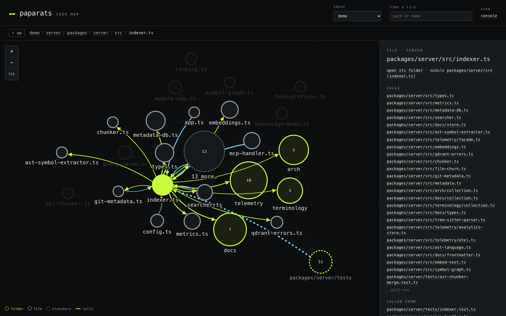

# Paparats MCP: self-hosted semantic code search for AI coding agents


[](https://www.npmjs.com/package/@paparats/cli)
[](LICENSE)
[](https://www.pulsemcp.com/servers/paparats-mcp)
[](https://lobehub.com/mcp/ibazylchuk-paparats-mcp)
[](https://glama.ai/mcp/servers/IBazylchuk/paparats-mcp)

**Paparats MCP is an open-source, self-hosted MCP server that gives Claude Code, Cursor,
Codex, GitHub Copilot and any other MCP client semantic code search across many
repositories: by meaning, with who calls what, and what a change will touch.** It runs on
your machine or your server in Docker, with local embedding models by default, so your
code stays with you.

Your agent asks _"where do we retry failed payments?"_ and gets the few functions that do
it, with file and line, instead of grepping and reading whole files. Before changing one,
it asks what depends on it and gets the callers up to three steps out and the tests that
reach them.

<a href="docs/module-map.png"></a>

<sub>The code map at <code>/ui/map</code>: this repository folder by folder, with arrows for who calls whom.</sub>

## Quick start

You need **Docker** with Compose v2 and **Node.js 24+**.

```bash
npm install -g @paparats/cli
brew install llama.cpp mostlygeek/llama-swap/llama-swap   # macOS only: local models with Metal

paparats install            # starts the stack, connects Claude Code and Cursor
paparats add ~/code/my-app  # or `.`, or a GitHub repo: paparats add acme/widgets
paparats list               # wait until the project shows as indexed
```

Then ask your agent:

> Search the codebase for where we handle failed payments, show me what calls it, and
> what would be affected if I changed it.

Other ways in:

- **No local models:** `paparats install --embeddings voyage --embedding-api-key pa-...`
  (or `openai`) skips the 2.3 GB of models; code is then sent to that provider to be
  embedded.
- **No CLI:** [`examples/docker-compose/`](examples/docker-compose/) has ready compose
  files. Edit `projects.yml`, run `docker compose up -d`.
- **Nothing local:**
  [](https://codespaces.new/IBazylchuk/paparats-mcp)
  runs the whole stack in your own Codespace, on this repository.

All install options, hardware and upgrading: [docs/install.md](docs/install.md).

## What your agent gets

- **`search_code`**: finds code by what it does, across every repository in a group. The
  file path is embedded with each chunk, and a query naming a class or function ranks its
  definition higher.
- **`find_usages`** and **`change_impact`**: a call graph by method, built from the syntax
  tree. `change_impact` lists what depends on the code you are about to change, marks the
  uncertain links and lists the tests apart.
- **`module_map`**: the modules of a codebase, worked out from who calls whom, with their
  main files and how they depend on each other. Also a page you can walk:
  `http://localhost:9876/ui/map`.
- **Git history per chunk**: who changed it, when, and the tickets named in the commit
  messages.
- **Architectural memory**: components, decisions and lessons the agent records as it
  works and reads before changes that cross components.
  [More](docs/architectural-memory.md).
- **Documentation search and a glossary**: your markdown, searched by meaning and keywords
  (opt-in), and a shared list of team terms. [More](docs/documentation-search.md).

Tools come on three endpoints: **coding** (`/mcp`) for the agent you write code with,
**support** (`/support/mcp`), read-only, for support people and bots, and **knowledge**
(`/knowledge/mcp`), documentation only, behind a token, for a service outside your
network. Every tool: [docs/tools.md](docs/tools.md).

## FAQ

### What is Paparats MCP?

An open-source (MIT) MCP server for semantic code search over many repositories. It runs
on your machine or server with Qdrant and local llama.cpp embeddings, and adds a call
graph, git history per chunk and agent-maintained architectural memory on top of the
search.

### How do I add semantic code search to Claude Code?

Run the [quick start](#quick-start): `paparats install` connects Claude Code (and Cursor)
by itself. By hand it is one command:

```bash
claude mcp add --scope user --transport http paparats http://localhost:9876/mcp
```

The [Claude Code plugin](docs/clients.md#claude-code-plugin) does the same and adds a skill
that tells Claude when to search by meaning and when to grep.

### Which MCP clients work?

Any client with Streamable HTTP, at `http://localhost:9876/mcp`. [docs/clients.md](docs/clients.md)
has the setup for Claude Code, Cursor, Codex, GitHub Copilot in VS Code, Windsurf,
Antigravity, Gemini CLI, Grok Build, Cline and clients that only start a process (stdio).

### Does my code leave my machine?

Not by default. Indexing, the embedding models (`bge-code-v1` for code,
`Qwen3-Embedding-0.6B` for prose, served by llama.cpp) and the vector store (Qdrant) all
run locally in Docker. Cloud embeddings (Voyage, OpenAI), a remote Qdrant and trace export
are opt-in. See [PRIVACY.md](PRIVACY.md).

### When should I use it, and when not?

Use it when grep-and-read loops eat your agent's context on a large codebase or many
repositories, or when several people and agents should share one index. Skip it for one
small repository, or for precise refactoring: that is a job for a language-server tool
such as [Serena](https://github.com/oraios/serena), which works well alongside Paparats.

### Can it search several repositories at once?

Yes. Projects in one group share a Qdrant collection, so one query covers backend,
frontend and infrastructure together. The call graph is built per project; calls from one
repository into another are not linked yet.

### How fresh is the index after I change code?

Within about 10 minutes. The indexer checks every repository every 10 minutes and indexes
only the files that changed, call graph included; a full pass runs every few hours.
`POST /trigger` on the indexer updates it at once, for example from CI. There is no file
watcher, so an edit is not searchable within seconds.

### Which languages are supported?

Syntax-based chunking and the call graph cover 11 languages: TypeScript (with TSX),
JavaScript, Python, Go, Rust, Java, Ruby, C, C++, C# and Terraform/HCL. Other files are
chunked by braces, indentation or blocks and have no call graph.

### What hardware does it need?

Docker with Compose v2 and Node.js 24+. Local models take about 2.3 GB of disk, and the
embed container 2–6 GB of RAM. CPU only works; on macOS the native build with Metal is much
faster. With a cloud provider there are no local models at all.

### Is there a hosted version or a public demo?

No, Paparats is self-hosted only. To try it without installing anything locally, open the
repository in [GitHub Codespaces](docs/install.md#github-codespaces).

### How is Paparats different from claude-context, Serena or codebase-memory-mcp?

[claude-context](https://github.com/zilliztech/claude-context) runs hybrid search over one
codebase path per query, with OpenAI and Zilliz Cloud in its quick start; Paparats runs
locally by default and searches many repositories at once.
[Serena](https://github.com/oraios/serena) drives language servers for precise lookup and
editing; Paparats finds code by meaning and has no editing tools.
[codebase-memory-mcp](https://github.com/DeusData/codebase-memory-mcp) is one native binary
with a local code graph and a lighter setup; Paparats is a shared server for many people
and agents, with a read-only support endpoint, git history per chunk and usage analytics.
These and Sourcegraph, side by side: [comparison with alternatives](docs/comparison.md).

## Documentation

| Page | What is in it |
| ---- | ------------- |
| [Install](docs/install.md) | `paparats install` and its options, plain `docker compose`, Codespaces, support mode, hardware, v1 migration |
| [Clients](docs/clients.md) | Setup for every MCP client, the note that tells an agent when to use it |
| [Tools](docs/tools.md) | Every tool on each endpoint, workflow prompts, typical flows |
| [Configuration](docs/configuration.md) | `projects.yml`, `.paparats.yml`, groups, freshness, CLI, environment variables |
| [How it works](docs/how-it-works.md) | Indexing, search and ranking, the call graph, the module map |
| [Architectural memory](docs/architectural-memory.md) | Components, decisions, lessons, the glossary |
| [Documentation search](docs/documentation-search.md) | Docs indexing, audience labels, the knowledge endpoint |
| [Embedding models](docs/embeddings.md) | Local and cloud models, how they were chosen |
| [Monitoring](docs/observability.md) | Prometheus, OpenTelemetry, the `/ui` console, token-savings estimates |
| [Comparison with alternatives](docs/comparison.md) | claude-context, Serena, codebase-memory-mcp, claude-context-local, Sourcegraph side by side |
| [Benchmarking](docs/benchmarking.md), [Chunking](docs/chunking-strategy.md), [Replacing models](docs/replacing-embedding-models.md), [Releasing](docs/releasing.md) | For contributors |

## Contributing

Issues and pull requests are welcome: more languages (PHP, Elixir, Scala, Kotlin, Swift),
more embedding providers, faster indexing, new agent use cases. Every pull request carries
a changeset; the release process is in [docs/releasing.md](docs/releasing.md). Changes to
search quality come with a `yarn bench compare` against `main`.

## The name

**Paparats-kvetka**, the fern flower, blooms in Slavic folklore on Kupala Night and lets
whoever finds it see hidden things. Paparats helps your agent see the right code in a sea
of repositories.

MIT license.
