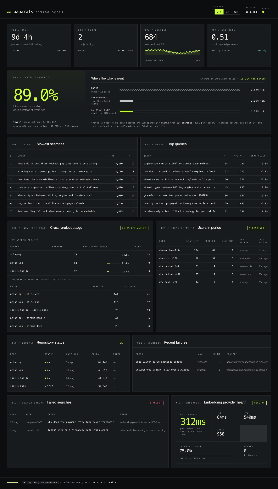

# Paparats MCP: self-hosted semantic code search for AI coding agents


[](https://www.npmjs.com/package/@paparats/cli)
[](LICENSE)
[](https://www.pulsemcp.com/servers/paparats-mcp)
[](https://lobehub.com/mcp/ibazylchuk-paparats-mcp)

[](https://glama.ai/mcp/servers/IBazylchuk/paparats-mcp)

[](https://codespaces.new/IBazylchuk/paparats-mcp) &nbsp;<sub>← try the full stack in your own Codespace, no local install ([details](#try-it-in-the-browser-no-install))</sub>

**Paparats MCP is an open-source, self-hosted MCP server that gives Claude Code, Cursor,
Codex, GitHub Copilot and any other MCP client semantic code search across many
repositories, without your code leaving your machine.** It indexes each repo with
tree-sitter AST chunking, builds a cross-chunk symbol graph (`find_usages`: calls, callers,
references), attaches git history and ticket references to every chunk, and stores vectors
in Qdrant using local llama.cpp embeddings (`bge-code-v1` for code, `Qwen3-Embedding-0.6B`
for docs). Install with `npm install -g @paparats/cli && paparats install`. It runs on your
own machine or server in Docker; there is no hosted SaaS.

**Use it when** grep-and-read loops burn your agent's context on a large or multi-repo
codebase, or when several people and agents should share one index. **Skip it when** you
have one small repo, or when you need precise refactors — that is a job for an LSP-based
tool such as [Serena](https://github.com/oraios/serena), which pairs well with Paparats.

**Paparats-kvetka** — a magical flower from Slavic folklore that blooms on Kupala Night
and grants whoever finds it the power to see hidden things. Likewise, Paparats MCP
helps your agent see the right code across a sea of repositories.

<a href="docs/dashboard.png"></a>

<sub>📊 The built-in `/ui` operator console — ROI, query quality, cross-project usage, per-user activity, indexer health. <em>Screenshot uses synthetic data (<code>?demo=1</code>) — no real queries, users, or project names.</em></sub>

- ⚡ **One install, one config.** `paparats install` → `paparats add ~/code/repo` → done.
- 🌳 **AST-aware chunking and symbol extraction.** Tree-sitter parses every supported
  file once and feeds both chunking and the cross-chunk symbol graph (calls /
  called_by / references / referenced_by) — 11 languages: TypeScript (incl. TSX),
  JavaScript, Python, Go, Rust, Java, Ruby, C, C++, C# and Terraform/HCL.
- 🧠 **Architectural memory that the agent maintains itself.** A second vector store
  per group holds **components, decisions (ADRs) and lessons learned** — your coding
  agent writes them as it works and reads them before cross-component changes. Bootstrap
  on day one with the `init_arch_memory` MCP prompt (the `/init` of architectural
  memory). Server-side similarity gate prevents duplicates, supersedes links replace
  stale decisions, a `min_score` threshold gates low-confidence reads, every card carries
  an "updated N ago" stamp, and Prometheus metrics tell you whether your memory is
  actually being used.
- 🔄 **Keeps itself fresh.** The indexer checks every repo for changes every 10 minutes
  (a `git ls-remote` for remote repos, a file mtime/size fingerprint for local ones),
  reindexes only what changed, and runs a full safety-net pass every few hours. A
  `POST /trigger` reindexes on demand, e.g. from CI.
- 💸 **Saves tokens.** Returns only the chunks that matter, with token-savings telemetry
  to estimate it (per-query, per-user, per-anchor-project).
- 🔭 **Production-ready observability.** Prometheus `/metrics`, OpenTelemetry traces
  (Tempo, Jaeger, Honeycomb, Datadog, Grafana Cloud, **Elastic APM**), local SQLite
  analytics, and a built-in `/ui` operator console that visualises ROI, query quality,
  cross-project usage and indexer health in one screen.
- 🏠 **100% local by default.** Qdrant + a local embed server (llama.cpp llama-server +
  llama-swap) on your machine. No cloud, no API keys, no telemetry leaving the box. Bring
  your own Qdrant Cloud / embed server URL, or a cloud embedding provider, if you want.

📏 **Benchmarked, not assumed:** `bge-code-v1` reaches Recall@5 **0.480** vs **0.408** for
`jina-code-embeddings-1.5b` on CoIR CosQA (20,604 code docs, 500 queries) — see the
[methodology](#model-benchmarks--methodology).

---

## Table of Contents

- [Why Paparats?](#why-paparats)
- [Quick start: install semantic code search locally](#quick-start-install-semantic-code-search-locally)
- [How the install works](#how-the-install-works)
- [Install variants](#install-variants)
- [Migrating from a v1 install](#migrating-from-a-v1-install)
- [Support agent setup](#support-agent-setup)
- [How It Works](#how-it-works)
- [Key Features](#key-features)
- [Architectural memory](#architectural-memory-agent-maintained-adrs-components-lessons)
- [Use Cases](#use-cases)
- [Configuration](#configuration)
- [MCP Tools Reference](#mcp-tools-reference)
- [How to connect Paparats to Claude Code, Cursor and other MCP clients](#how-to-connect-paparats-to-claude-code-cursor-and-other-mcp-clients)
- [CLI Commands](#cli-commands)
- [Monitoring and observability](#monitoring-and-observability)
- [Architecture](#architecture)
- [Embedding Model Setup](#embedding-model-setup)
- [FAQ](#faq)
- [Comparison with Alternatives](#comparison-with-alternatives)
- [Token Savings Metrics](#token-savings-metrics)
- [Contributing](#contributing)
- [Links](#links)

---

## Why Paparats?

AI coding assistants are smart, but they can only see files you open. They don't know your codebase structure, where the authentication logic lives, or how services connect. **Paparats fixes that.**

### What you get

- **Semantic code search** — ask "where is the rate limiting logic?" and get exact code ranked by meaning, not grep matches
- **Automatic freshness** — the indexer notices changed repos within about 10 minutes and reindexes only the changed files; trigger a reindex over HTTP when you need it sooner
- **Cross-chunk symbol graph** — `find_usages` walks AST-derived edges (calls, called_by, references, referenced_by) so the agent can trace dependencies without re-grepping; `change_impact` follows callers a few steps out before a change, tests listed apart
- **Token savings** — return only relevant chunks instead of full files to reduce context size
- **Multi-project workspaces** — search across backend, frontend, infra repos in one query
- **100% local & private** — Qdrant vector database + local llama-server embeddings. Nothing leaves your laptop
- **AST-aware chunking** — code split by AST nodes (functions/classes) via tree-sitter, not arbitrary character counts (TypeScript/TSX, JavaScript, Python, Go, Rust, Java, Ruby, C, C++, C#, Terraform/HCL; regex fallback for other file types)
- **Rich metadata** — each chunk knows its symbol name (from tree-sitter AST), service, domain context, and tags from directory structure
- **Git history per chunk** — see who last modified a chunk, when, and which tickets (Jira, GitHub) are linked to it
- **Architectural memory** — a living knowledge base of components, decisions (ADRs) and lessons learned, written by the coding agent as it learns, deduplicated server-side by vector similarity, and consulted before cross-component changes so the agent stays consistent across sessions
- **Docs and glossary** — optional hybrid search over your markdown documentation, and a shared glossary of team vocabulary that agents can read and extend

### Who benefits

| Use Case                    | How Paparats Helps                                                                                     |
| --------------------------- | ------------------------------------------------------------------------------------------------------ |
| **Solo developers**         | Quickly navigate unfamiliar codebases, find examples of patterns, reduce context-switching             |
| **Multi-repo teams**        | Cross-project search (backend + frontend + infra), consistent patterns, faster onboarding              |
| **AI agents**               | Foundation for product support bots, QA automation, dev assistants — any agent that needs code context |
| **Legacy modernization**    | Find all usages of deprecated APIs, identify migration patterns, discover hidden dependencies          |
| **Contractors/consultants** | Accelerate ramp-up on client codebases, reduce "where is X?" questions                                 |

---

<a id="quick-start"></a>

## Quick start: install semantic code search locally

### Try it in the browser (no install)

[](https://codespaces.new/IBazylchuk/paparats-mcp)

Spin up a full Qdrant + embed server + paparats stack in your own Codespace (this is
not a hosted Paparats service — it runs in your GitHub account). A small slice of the
repo (`packages/shared/src`) is auto-indexed on first start so you can run

```bash
paparats search -g demo 'gitignore filter'
```

within a few minutes. Codespace forwards port 9876 for MCP — point Cursor/Claude Code
at it via the URL VS Code shows in the Ports panel.

> Note: Codespaces is for demo only. With CPU embedding the full repo
> would take 15+ minutes and can hit batch timeouts on large files. For real
> workloads run locally — or set `OPENAI_API_KEY` (or `VOYAGE_API_KEY`) as a
> Codespaces user secret and indexing drops to a couple of seconds; see
> [Embedding Model Setup](#embedding-model-setup).

### Run locally

You need **Node.js 24+**, **Docker** and **Docker Compose v2**. On macOS, also install the
**embed server natively** — running it inside Docker on macOS is significantly slower
because the Docker VM cannot use Apple Silicon GPU (Metal) acceleration.

```bash
# 1. Install the CLI.
npm install -g @paparats/cli

# 2. macOS only — install the native embed server (Linux uses the Docker embed
#    image by default). Metal-accelerated.
brew install llama.cpp mostlygeek/llama-swap/llama-swap

# 3. One-time bootstrap. Generates ~/.paparats/{docker-compose.yml,projects.yml},
#    starts the stack, downloads the embedding models (~2 GB), wires Cursor MCP.
paparats install

# 4. Add the projects you want indexed. Local paths bind-mount read-only into the
#    indexer; GitHub repos (URL or owner/repo shorthand) get cloned.
paparats add ~/code/my-project
paparats add git@github.com:acme/billing.git
paparats add acme/widgets

# 5. Watch it work.
paparats list
```

That's it. When Cursor is installed (`~/.cursor` exists), it is already wired
(`~/.cursor/mcp.json`) to `http://localhost:9876/mcp`; for Claude Code run
`claude mcp add --scope user --transport http paparats http://localhost:9876/mcp`
(see [connecting MCP clients](#how-to-connect-paparats-to-claude-code-cursor-and-other-mcp-clients)).
Open Cursor or Claude Code and ask:

> "Search this workspace for the auth middleware and show me everything that calls it."

### Existing v1 user?

Just run `paparats install` again. The installer detects the legacy per-project
compose, asks once before swapping it for the new global setup, and **preserves your
indexed data** (Qdrant collections, SQLite metadata, embedding cache). Your in-repo
`.paparats.yml` files keep working as the base config for each project.

---

## How the install works

`paparats install` is the only setup command. It creates a single global home at
`~/.paparats/`, brings up a Docker stack, and wires your MCP clients. Re-run it any time
to reconfigure — it diffs the existing compose and asks before overwriting hand edits.

```
~/.paparats/
├── docker-compose.yml          generated; hand-editable; install asks before overwriting
├── projects.yml                project list (CLI rewrites it; see the note in the file about comments)
├── install.json                install flags persisted so add/remove can regenerate compose; chmod 600
├── .env                        secrets and overrides — Qdrant API key, GitHub token; chmod 600
├── models/                     bge-code-v1 + qwen3-embedding-0.6b GGUF (native embed mode)
└── llama-swap.yaml, llama-swap.log   native embed server config and log (native embed mode)
```

Indexed data does not live in this directory. It is kept in named Docker volumes created
by the compose file: `qdrant_data` (vector index), `paparats_data` (metadata,
embedding cache and analytics SQLite files) and `indexer_repos` (cloned remote
projects). The whole `~/.paparats` directory is bind-mounted read-only into the indexer at
`/config`, which is how it sees `projects.yml`.

Inside the Docker stack:

| Service            | Image                          | Host port | Role                                                     |
| ------------------ | ------------------------------ | --------- | -------------------------------------------------------- |
| `paparats`         | `ibaz/paparats-server:latest`  | 9876      | MCP HTTP endpoints, search, metadata API                 |
| `paparats-indexer` | `ibaz/paparats-indexer:latest` | 9877      | Scheduled + on-demand indexing, hot-reload of project list |
| `qdrant`           | `qdrant/qdrant:latest`         | 6333      | Vector DB (skipped when you pass `--qdrant-url`)         |
| `embed`            | `ibaz/paparats-embed:latest`   | 18434     | Embed server — llama-server + llama-swap, `bge-code-v1` + `qwen3-embedding-0.6b` pre-baked. Docker embed mode only (Linux default); on macOS the native embed server listens on the same port. llama-swap listens on 8080 inside the container |

Host ports can be changed with `PAPARATS_PORT`, `INDEXER_PORT`, `QDRANT_PORT` and
`EMBED_PORT` in `~/.paparats/.env`. The embed port is 18434 rather than Ollama's 11434 so
the two can run side by side.

The indexer hot-reloads `projects.yml`. Edits that **change project metadata
only** (group, language, indexing tweaks) reindex in place; when the group changes, the
project's data in the old group is purged. Deleting an entry purges its chunks, metadata
and docs. Edits that **add or remove local-path projects** require a stack restart so
Docker picks up the new bind-mount — the CLI does this for you on `paparats add` and
`paparats remove`.

---

## Install variants

### Default (recommended)

```bash
paparats install
```

On macOS prefers the native embed server and dockerized Qdrant. On Linux defaults to
Docker for both.

### Bring your own Qdrant

```bash
paparats install --qdrant-url https://qdrant.example.com
# Asks for an API key after; stored in ~/.paparats/.env as QDRANT_API_KEY.
```

When `--qdrant-url` is set the Qdrant container is omitted from the stack entirely.

### Bring your own embed server

```bash
paparats install --embed-url http://10.0.0.5:18434
```

Skips both the native and Docker embed server.

> **The remote endpoint must serve the `bge-code-v1` model (and `qwen3-embedding-0.6b` for the
> arch-memory and docs layers) over an OpenAI-style `/v1/embeddings` API.** The installer will
> not touch a remote instance. The simplest way is to run the pre-baked image on that host —
> no model registration needed, llama-swap loads GGUF by name on first request:
>
> ```bash
> docker run -d -p 18434:8080 ibaz/paparats-embed:latest
> ```
>
> Then `paparats install --embed-url http://that-host:18434` and Paparats will use it.

### Use a cloud embedding provider

```bash
paparats install --embeddings openai --embedding-api-key sk-...
paparats install --embeddings voyage --embedding-api-key pa-...
```

Skips the local embed service for code embeddings. Code chunks and queries are then sent
to that provider — see [Embedding Model Setup](#embedding-model-setup) and
[PRIVACY.md](PRIVACY.md).

### Force Docker embed server on macOS

```bash
paparats install --embed-mode docker
```

Slower on Apple Silicon (no Metal GPU), but useful for parity testing or laptops without
brew.

### Scripted / CI

```bash
paparats install --non-interactive --force
```

Fails on any prompt; `--force` answers Y to compose-overwrite and migration prompts.

---

## Migrating from a v1 install

When `paparats install` finds a legacy `~/.paparats/docker-compose.yml` (the one from the
old per-project flow with no `paparats-indexer` service), it prints a one-screen
migration notice and asks before tearing the legacy stack down.

**What survives:** Qdrant collections, SQLite metadata, indexer repos, and any
`.paparats.yml` files inside your repos (they stay the base config for each project;
`group`, `docs` and `indexing` overrides from `projects.yml` are layered on top).

**What's deleted:** the legacy `docker-compose.yml` and `.env`. They are regenerated on
the spot under the new schema.

**No re-indexing needed** — the data volumes are referenced by the same names in the new
compose. Add your projects with `paparats add` and they re-appear in `paparats list` with
their existing chunks.

If your install predates the `paparats-indexer.yml` → `projects.yml` rename, the
installer migrates the file in place on first run and prints a one-line notice.
The indexer also reads the legacy name as a fallback, so nothing breaks if you
roll out the indexer before re-running `paparats install`.

Pass `--force` to skip the migration prompt in scripts.

---

## Support agent setup

For bots and support teams that consume an existing Paparats server — no Docker, no
embed server needed on this side.

```bash
# Connect to a running server (default: localhost:9876)
paparats install --mode support

# Connect to a remote server
paparats install --mode support --server http://paparats.example.com:9876
```

The installer verifies the server is reachable, then wires Cursor MCP
(`~/.cursor/mcp.json`) and Claude Code (user scope, via `claude mcp add`; when the `claude`
CLI isn't on your PATH it prints the command to run instead) to the support
endpoint. Tools available on `/support/mcp`: `search_code`, `get_chunk`, `find_usages`,
`list_projects`, `health_check`, `get_chunk_meta`, `search_changes`, `explain_feature`,
`recent_changes`, `impact_analysis`, `search_docs`, `get_document`, `term_search`,
`term_list`, plus the six analytics tools described in
[Monitoring and observability](#monitoring-and-observability). The support endpoint is
read-only — it writes nothing to the index, glossary or architectural memory — see the
[MCP Tools Reference](#mcp-tools-reference).

---

## How It Works

```
Your projects                   Paparats                       AI assistant
                                                               (Claude Code / Cursor)
  backend/                 ┌──────────────────────┐
    .paparats.yml ────────►│  Indexer              │
  frontend/                │   - chunks code       │          ┌──────────────┐
    .paparats.yml ────────►│   - embeds via llama  │─────────►│ MCP search   │
  infra/                   │   - stores in Qdrant  │          │ tool call    │
    .paparats.yml ────────►│   - re-checks on cron │          └──────────────┘
                           └──────────────────────┘
```

### Indexing Pipeline

During each indexer cycle (the scheduled change check or full pass, `paparats add`, a
`projects.yml` edit, or a `POST /trigger`), every file in scope flows through this
pipeline:

```
 Source file
     │
     ▼
 ┌─────────────────┐
 │ 1. File discovery│  Collect files from indexing.paths, apply
 │    & filtering   │  gitignore + exclude patterns, skip binary
 └────────┬────────┘
          ▼
 ┌─────────────────┐
 │ 2. Content hash  │  SHA-256 of file content → compare with
 │    check         │  existing Qdrant chunks → skip unchanged
 └────────┬────────┘
          ▼
 ┌─────────────────┐
 │ 3. AST parsing   │  tree-sitter parses the file once (WASM)
 │    (single pass) │  → reused for chunking AND symbol extraction
 └────────┬────────┘
          ▼
 ┌─────────────────┐
 │ 4. Chunking      │  AST nodes → chunks at function/class
 │                  │  boundaries. Regex fallback for unsupported
 │                  │  languages (brace/indent/block strategies)
 └────────┬────────┘
          ▼
 ┌─────────────────┐
 │ 5. Symbol        │  AST queries extract module-level defines
 │    extraction    │  (function/class/variable names) and uses
 │                  │  (calls, references) per chunk. 11 languages
 └────────┬────────┘
          ▼
 ┌─────────────────┐
 │ 6. Metadata      │  Service name, bounded_context, tags from
 │    enrichment    │  config + auto-detected directory tags
 └────────┬────────┘
          ▼
 ┌─────────────────┐
 │ 7. Embedding     │  bge-code-v1 (code, 1536d) via llama-server
 │                  │  SQLite cache (content-hash key) → skip
 │                  │  already-embedded content
 └────────┬────────┘
          ▼
 ┌─────────────────┐
 │ 8. Qdrant upsert │  Vectors + payload (content, file, lines,
 │                  │  symbols, metadata) → batched upsert
 └────────┬────────┘
          ▼
 ┌─────────────────┐
 │ 9. Git history   │  git log per file → diff hunks → map
 │    (post-index)  │  commits to chunks by line overlap →
 │                  │  extract ticket refs → store in SQLite
 └────────┬────────┘
          ▼
 ┌─────────────────┐
 │10. Symbol graph  │  Cross-chunk edges: calls ↔ called_by,
 │    (post-index)  │  references ↔ referenced_by → SQLite
 └─────────────────┘
```

Step 5's symbol extractor only emits **module-level** definitions — locals declared
inside function bodies, callback args, and hook closures stay out of the graph because
they're not addressable from another chunk anyway. The chunking design is explained in
[docs/chunking-strategy.md](docs/chunking-strategy.md).

When `INDEX_DOCS=true` is set on the indexer, each repo's markdown also goes through a
separate docs pass into the documentation layer (see
[Documentation search](#documentation-search-opt-in)).

### Search Flow

AI assistant queries via MCP → server detects query type (natural language → code, code → code, technical question) → wraps the query in the matching `bge-code-v1` instruction → searches Qdrant once, adding the chunks that define any class or function the query names → re-ranks (definitions of named identifiers up, test files down unless the query asks about tests, often-changed files slightly up) → only relevant chunks returned with confidence scores and symbol info. Code chunks are embedded with their file path (`Filepath: <path>` above the chunk); results show the plain chunk.

### Keeping the index fresh

The indexer container decides when to reindex; the MCP server never watches your files.
Three mechanisms keep the index in step with your code:

- **Fast change check** (`CRON_FAST`, default `*/10 * * * *` — every 10 minutes). For each
  repo the indexer takes a fingerprint — `git ls-remote <url> HEAD` for remote repos, a
  hash of (path, mtime, size) over the project's file set for bind-mounted local paths —
  and reindexes the repo only when it differs from the last successful run. Unchanged
  files are skipped by content hash and are never re-embedded.
- **Full safety-net pass** (`CRON`). Reindexes every repo regardless of the fingerprint.
  The indexer's built-in default is every 3 hours (`0 */3 * * *`); the compose file that
  `paparats install` generates sets every 6 hours (`0 */6 * * *`).
- **On demand.** `paparats add` reindexes the project it adds, saving
  `paparats edit projects` triggers a full indexing cycle (unchanged files are skipped by
  content hash), and `POST http://localhost:9877/trigger`
  reindexes one, several or all repos (see [CI/CD reindex on push](#cicd-reindex-on-push)).

Both schedules can be set in `projects.yml` (`defaults.cron_fast`, `defaults.cron`) or in
the indexer environment. `CHANGE_DETECTION=false` turns the fast check off and leaves only
the full pass. The server caches search results for up to 5 minutes, so a repeated
identical query can return the previous answer until its cache entry expires.

The indexer also hot-reloads `~/.paparats/projects.yml` itself: metadata-only edits
reindex in place; add/remove of local-path projects triggers a stack restart through the
CLI.

---

## Key Features

### Better Search Quality

**Task-specific embeddings** — `bge-code-v1` is instruction-tuned, so each query is
wrapped in the instruction its model card gives for the detected query type (documents are
embedded without one). The docs and architecture layers use Qwen3-Embedding's single
retrieval instruction:

- `"find authentication middleware"` → natural language → code (CosQA instruction)
- `"function validateUser(req, res)"` → code → similar code (CodeTrans-DL instruction)
- `"how does OAuth work in this app?"` → technical question (StackOverflow-QA instruction)

**Query expansion** (support-mode `explain_feature` and `impact_analysis` only) — the question is searched in 2-3 variations:

- Abbreviations: `auth` ↔ `authentication`, `db` ↔ `database`
- Case variants: `userAuth` → `user_auth` → `UserAuth`
- Plurals: `users` → `user`, `dependencies` → `dependency`
- Filler removal: `"how does auth work"` → `"auth"`

All variants searched in parallel, results merged by max score. `search_code` searches the query once: on the [retrieval bench](docs/benchmarking.md) the variants added no quality there and cost up to three embedding calls and Qdrant queries per search.

**Ranking** (`search_code`) — when the query names a class or function (`InvoiceTotal`, `charge_card`, `Billing::Invoice`), the chunks that define it join the candidates and rank higher, as do files named after it. Test files rank slightly lower unless the query mentions tests, and files with more commits slightly higher. Only the order changes: the confidence score stays the similarity.

**Confidence scores** — each result includes a percentage score (≥60% high, 40–60% partial, <40% low) to guide AI next steps.

### Performance

**Embedding cache** — SQLite cache with content-hash keys + Float32 vectors. Unchanged code never re-embedded. LRU cleanup at 100k entries.

**AST-aware chunking** — tree-sitter AST nodes define natural chunk boundaries for 11 languages. Falls back to regex strategies (block-based, brace-based, indent-based, fixed-size) for other file types and for files where AST chunking yields nothing.

**Change detection** — a cheap fingerprint per repo every 10 minutes means an unchanged
repo costs one `git ls-remote` or one directory stat, not a reindex. See
[Keeping the index fresh](#keeping-the-index-fresh).

### Cross-chunk symbol graph

The post-index pass walks every chunk's `defines_symbols` / `uses_symbols` lists and
materializes edges into SQLite — `calls`, `called_by`, `references`, `referenced_by`.
`find_usages` returns those edges grouped by direction so the agent can traverse the
graph without re-searching. Because extraction is AST-driven, function locals don't
pollute the graph.

### Architectural memory (agent-maintained ADRs, components, lessons)

Code search tells the agent **what the code does**. Architectural memory tells it
**why** — and the agent maintains that knowledge itself, across sessions, without you
authoring a single doc.

**Three card kinds, structured by design:**

| Kind          | Captures                                                                                  | Fields                                                            |
| :------------ | :---------------------------------------------------------------------------------------- | :---------------------------------------------------------------- |
| **Component** | A unit with a clear responsibility (service, module, subsystem)                           | `name`, `summary` with `Does / Owns / Does not / Touched when`    |
| **Decision**  | An architectural choice (ADR-style)                                                       | `title`, `context`, `decision`, `alternatives_rejected`, `consequences` |
| **Lesson**    | A rule learned from an incident, a code review, a bug, or a user correction (Reflexion-style) | `rule`, `why`, `when`                                             |

The agent reads them via **`arch_context`** before any architectural answer, and
writes them via **`arch_record_component`**, **`arch_record_decision`**, and
**`arch_record_lesson`** whenever it discovers something new or learns from a
correction. **`arch_list`** enumerates every card (for audits), **`arch_suggest_components`**
proposes the most-called files not yet covered by a component card, and **`arch_delete`**
removes obsolete cards. Each card carries an `updated N ago` stamp in the read tool so the
agent can spot stale memory and verify against current code.

**Server-side similarity gate** (cosine over [Qwen3-Embedding-0.6B](https://huggingface.co/Qwen/Qwen3-Embedding-0.6B)
text embeddings, 1024d):

- `≥ 0.85` is a **duplicate** — decisions are refused (the agent must reconcile or
  supersede); lessons bump `updatedAt` (Reflexion-style "rule confirmed").
- `0.70 – 0.85` is **similar** — surfaced to the agent so it can refine the wording
  or chain a supersede.
- `< 0.70` is **new** — accepted as a fresh card.

`supersedes` links bypass the gate and mark the prior decision as `status=superseded`
so it disappears from default search but remains in history.

**Why this matters:**

- 🧠 **Cross-session continuity** — what the agent learned last week, today's agent
  still knows.
- 📝 **ADRs without the ceremony** — no markdown files to maintain, no review process,
  no doc drift. The agent writes when it learns.
- 🔄 **Reflexion built in** — corrections become lessons; repeated mistakes get caught.
- 🚦 **No memory rot** — similarity gate kills duplicates, supersedes link replaces
  stale decisions, age stamps trigger verification against code.

Lives in a separate Qdrant collection per group (`paparats_<group>_arch`). The layer is
**coding-only, for reads and writes alike**: every `arch_*` tool is on the coding endpoint
(`/mcp`), where the agent can verify a card against the code. The support endpoint has no
arch tools — a rationale it cannot check against code is not something support should
quote, so support routes "why is it built this way?" questions to an engineer.

**`arch_context` accepts a `min_score` parameter** (default `0.45`, cosine over
[Qwen3-Embedding-0.6B](https://huggingface.co/Qwen/Qwen3-Embedding-0.6B)). Lower it to broaden recall on a sparse
arch memory; raise it to demand only high-confidence cards. The tool also emits an
explicit low-confidence hint when the question matched nothing above the threshold,
so the agent knows to either rephrase or lower `min_score` instead of inventing
context.

**Initialise the arch layer on day one.** Three purpose-built MCP **workflow prompts** on
the coding endpoint make the boring scaffolding work disappear:

- **`init_arch_memory`** — the `/init` of architectural memory. Walks the repo,
  identifies 8-20 components by domain boundary, writes them, and captures any
  obvious decisions inferable from comments or README. Run it once per group, right
  after installing.
- **`audit_architecture`** — sweeps the memory of one group, flags cards older than
  90 days, verifies anchors against the live code, and surfaces a punch list of
  updates / supersedes for your approval.
- **`record_lesson_from_correction`** — converts a user correction into a structured
  lesson card (rule / why / when) without overrecording typos.

**MCP resources for live introspection** (coding and support endpoints):

- **`context://project-overview`** — indexed groups and projects with chunk counts.
- **`arch://schema`** — the full card-schema reference (fields, similarity-gate
  thresholds, write semantics). Cite it from the agent when explaining the model.
- **`arch://stats/{group}`** — live counts (total / by kind / by status) and the
  oldest/newest `updatedAt` per group. The same numbers are also pushed to
  Prometheus.

**Observability built in.** When `PAPARATS_METRICS=true`, every read/write hits a
counter and the cosine score of returned cards lands in a histogram:

- `paparats_arch_context_calls_total{group}` — calls per group
- `paparats_arch_write_total{kind, status}` — writes by card kind and gate outcome
- `paparats_arch_search_score` — histogram of cosine scores in `arch_context`
  results (post `min_score`)
- `paparats_arch_collection_size{group, kind, status}` — gauge updated whenever
  `arch://stats/{group}` is read

These let you spot a memory that's not being written to, a similarity gate that's
too aggressive, or a sparse group where every query returns low-confidence hits.

### Documentation search (opt-in)

With `INDEX_DOCS=true` on the indexer, each repo's markdown is indexed into a separate
collection per group (`paparats_<group>_docs`) with Qwen3-Embedding-0.6B. `search_docs`
runs a hybrid search — dense vectors plus BM25 keywords, fused with reciprocal rank
fusion (RRF) — and returns excerpts with their heading path and source link;
`get_document` (support and knowledge endpoints) returns a whole document section by
section. Every document carries an [audience label](#documentation-audience-labels) that
the endpoints can filter on.

`INDEX_DOCS` is off by default and the generated compose does not set it, so on a
default install `search_docs`, `get_document` and the knowledge endpoint return nothing.
To turn it on, add `INDEX_DOCS: 'true'` to the `environment:` block of the
`paparats-indexer` service in `~/.paparats/docker-compose.yml` (`paparats edit compose`)
and run `paparats restart` — and see the note on
[hand edits](#environment-variables) being regenerated.

### Glossary

A per-group glossary (`paparats_<group>_terms`) holds team vocabulary — abbreviations,
product names, domain terms — with a definition and aliases. `term_search` and
`term_list` read it on both the coding and support endpoints; `term_record` and
`term_delete` are coding-only, since support is read-only (it hands new vocabulary to an
engineer). Like
decisions, new terms pass a duplicate/similar gate, so a near-identical term is returned
instead of being written twice.

### Workflow prompts per endpoint

| Endpoint             | Prompts                                                                                                                  |
| :------------------- | :----------------------------------------------------------------------------------------------------------------------- |
| Coding (`/mcp`)      | `find_implementation`, `trace_callers`, `onboard_to_project`, `init_arch_memory`, `audit_architecture`, `record_lesson_from_correction` |
| Support (`/support/mcp`) | `triage_incident`, `prepare_release_notes`, `assess_change_impact`, `onboard_to_project`                              |
| Knowledge (`/knowledge/mcp`) | none                                                                                                             |

---

## Use Cases

### For Developers (Coding)

Connect via the **coding endpoint** (`/mcp`):

| Use Case                       | How                                                                    |
| ------------------------------ | ---------------------------------------------------------------------- |
| **Navigate unfamiliar code**   | `search_code "authentication middleware"` → exact locations            |
| **Find similar patterns**      | `search_code "retry with exponential backoff"` → examples              |
| **Trace dependencies**         | `find_usages {chunk_id, direction: "incoming"}` → callers via the graph |
| **Check before changing**      | `change_impact {chunk_id}` → callers up to 3 steps out, and the tests that reach the code |
| **Explore context**            | `get_chunk <chunk_id> --radius_lines 50` → expand around               |
| **Manage projects**            | `list_projects` and `delete_project` for index hygiene                 |
| **Architectural Q&A**          | `arch_context "why X"` → components / decisions / lessons (with age)   |
| **Capture decisions & lessons**| `arch_record_decision` / `arch_record_lesson` — agent writes as it learns, server-side dedup |

### For Support Teams

Connect via the **support endpoint** (`/support/mcp`):

| Use Case                       | How                                                                    |
| ------------------------------ | ---------------------------------------------------------------------- |
| **Explain a feature**          | `explain_feature "rate limiting"` → code locations + changes          |
| **Recent changes**             | `recent_changes "auth" --since 2024-01-01` → timeline with tickets     |
| **Trace usages**               | `find_usages {chunk_id}` → who calls/references this chunk             |
| **Change history**             | `get_chunk_meta <chunk_id>` → authors, dates, linked tickets           |
| **Blast radius**               | `impact_analysis "payment retry"` → dependents grouped by service      |
| **Look up team vocabulary**    | `term_search "abbreviation"` → definition and aliases                  |
| **Read the docs**              | `search_docs "refund policy"` → excerpts; `get_document` → full page   |

**Support chatbot example:**

```
User: "How do I configure rate limiting?"

Bot workflow (via /support/mcp):
1. explain_feature("rate limiting", group="my-app")
   → returns code locations + recent changes + related modules
2. get_chunk_meta(<chunk_id>)
   → returns who last modified it, when, linked tickets
3. Bot synthesizes response in plain language with ticket references
```

---

## Configuration

Paparats uses two config files. Both are optional — defaults work for the common case.

### `~/.paparats/projects.yml` — global project list

Lives outside your repos. Edited by `paparats add` / `paparats remove` or by hand via
`paparats edit projects`. Every entry has either `path:` (local bind-mount) or `url:`
(remote git, cloned by the indexer), never both.

```yaml
defaults:
  cron: '0 */6 * * *' # full safety-net pass
  cron_fast: '*/10 * * * *' # change check (fingerprint per repo)
  group: workspace # default group when an entry doesn't specify one

repos:
  - path: /Users/alice/code/billing # local bind-mount
    group: dev
    language: typescript

  - url: org/widgets # remote git, cloned by the indexer
    group: prod
    language: ruby

  - url: acme/billing-service # always owner/repo on github.com
    name: billing # override the auto-derived name
    group: prod
```

The indexer hot-reloads this file. Adding/removing **local-path** entries causes the CLI
to restart the stack so Docker picks up the new bind-mount; metadata-only edits reindex
in place, and removed entries are purged from the index. Remote entries are GitHub
repositories written as `owner/repo`; `paparats add` rejects other hosts.

### `.paparats.yml` in your repo — per-project config

The base config for one repo, committed with it. `projects.yml` can layer `group`, `docs`
and `indexing` overrides on top (see below).

```yaml
group: my-app
language: typescript

# Indexing tuning (all optional)
indexing:
  paths: [src, packages] # restrict to these subdirectories
  exclude: [node_modules, dist, '**/*.test.ts']
  exclude_extra: ['**/__fixtures__/**'] # added on top of language defaults
  chunkSize: 1500 # characters per chunk, 128–8192 (default: 1024)
  overlap: 100 # chunk overlap (default: 128)
  concurrency: 4 # parallel embedding requests (default: 2)
  batchSize: 8 # embeddings per llama-server call (default: 50)

# Metadata
metadata:
  service: billing
  bounded_context: payments
  tags: [backend, critical]
  directory_tags:
    src/api: [public-api]
    src/internal: [internal]

  # Git history per chunk (Jira / GitHub ticket extraction included)
  git:
    enabled: true
    maxCommitsPerFile: 50
    ticketPatterns:
      - '\b([A-Z]+-\d+)\b' # Jira-style PROJ-123
      - '#(\d+)' # GitHub-style #123

# Documentation layer (the repo's markdown, served by search_docs; needs INDEX_DOCS=true)
docs:
  kind: prose # prose | code — omit to auto-detect
  audience: client # default visibility label for this repo's docs — omit = internal
```

An in-repo `.paparats.yml` is the base config for that repo; `group`, `docs.kind`,
`docs.audience` and `indexing.*` set for it in `projects.yml` (directly or via `defaults`)
are layered on top and win, and the indexer's `PAPARATS_GROUP` overrides any group. The
CLI never overwrites it.

Exclude patterns follow `.gitignore` rules: a bare name (`dist`, `*.log`) matches at any
depth, a pattern containing `/` (`spec/fixtures`, `/tmp`) is relative to the project root,
and either one excludes everything beneath a matching directory. `indexing.paths` takes
directories relative to the project root (`*` wildcards allowed); other glob syntax,
absolute paths, `..`, and symlinks resolving outside the project are rejected, and
symlinked files pointing outside the project or into `.git` are never indexed.

### Groups

A **group** is a Qdrant collection (`paparats_<group>`). Multiple projects can share a
group to enable cross-project search; each project lives as a `project:` field in the
chunk payload. A project without a group gets `defaults.group` from `projects.yml`, or
the literal group `default` when that is unset — so by default all your projects share
one collection, `paparats_default`, and one query searches all of them. Set different
`group:` values to keep sets of projects apart.

### Git history per chunk

When `metadata.git.enabled: true` (default), the indexer maps each chunk to the commits
that touched its line range using diff-hunk overlap. Tickets are extracted from commit
messages using `metadata.git.ticketPatterns` (built-in: Jira `PROJ-123`, GitHub `#42`,
cross-repo `org/repo#99`). Surfaced through MCP tools `get_chunk_meta`, `search_changes`,
`recent_changes`, `explain_feature`. Non-fatal: non-git projects index normally.

### Documentation audience labels

Every indexed markdown document carries one **audience** label, and `search_docs` /
`get_document` can be limited to some labels. That is how one index serves internal
readers and a narrower audience (see the [knowledge endpoint](#knowledge-endpoint-knowledgemcp))
without the narrower one ever seeing internal pages. Docs are only indexed when the
indexer runs with `INDEX_DOCS=true` (see [Documentation search](#documentation-search-opt-in)).

A document's label is decided at index time, first match wins:

1. its own frontmatter — `audience: client` in the leading `---` block;
2. the project default — `docs.audience` in `.paparats.yml`, or in `projects.yml`
   (per repo, or under `defaults.docs`; a repo's value beats `defaults`, and a
   `projects.yml` value beats the repo's own `.paparats.yml`);
3. otherwise `internal`.

```markdown
---
title: Leave policy
source_url: https://docs.example.com/leave-policy
audience: client
---

# Leave policy
```

```yaml
# projects.yml
repos:
  - url: org/handbook
    docs:
      audience: client # every page of the repo, unless its frontmatter says otherwise
```

Labels are lower-case letters, digits, `-` and `_`, at most 64 characters
(`^[a-z0-9][a-z0-9_-]{0,63}$`). An invalid label in either config file stops the config
from loading. An invalid frontmatter value (wrong case, empty, a list) is logged with the
file and the value, and that document is stored as `internal` — never as the project
default, which may be wider than the author meant. Each indexing run rewrites every
document, so a changed label takes effect on the next run; nothing needs migrating.

`PAPARATS_DOCS_AUDIENCE=client,public` caps what the coding and support endpoints of one
server may return. The knowledge endpoint has a ceiling of its own.

---

## MCP Tools Reference

Paparats serves the Model Context Protocol on **three separate endpoints**, each with its
own tool set and system instructions: coding (`/mcp`), support (`/support/mcp`) and the
opt-in, docs-only knowledge endpoint (`/knowledge/mcp`).

### Coding endpoint (`/mcp`)

For developers using Claude Code, Cursor, etc. Focus: search code, read chunks, follow
the cross-chunk symbol graph, maintain architectural memory and the glossary, manage
projects.

| Tool                      | Description                                                                                                                  |
| :------------------------ | :--------------------------------------------------------------------------------------------------------------------------- |
| `search_code`             | Semantic search across indexed projects. Returns chunks with symbol info and confidence scores.                              |
| `get_chunk`               | Retrieve a chunk by ID with optional surrounding context.                                                                    |
| `find_usages`             | Walk the symbol graph from a `chunk_id` — `incoming` (callers/references in), `outgoing` (calls/references out), or `both`.  |
| `change_impact`           | What depends on a chunk you are about to change: callers, their callers (up to 3 steps) and the tests that reach it, with `[maybe]` on links through a name defined in several places. `symbol` narrows to one name, `whole_file` takes the whole file. |
| `list_projects`           | List indexed projects with chunk counts and detected languages.                                                              |
| `delete_project`          | Wipe Qdrant chunks + SQLite metadata for a project (`paparats remove` uses the equivalent HTTP endpoint).                    |
| `health_check`            | Indexing status, chunks per group, running jobs.                                                                             |
| `search_docs`             | Hybrid (dense + BM25, RRF-fused) search over indexed markdown documentation. Needs `INDEX_DOCS=true` on the indexer.         |
| `arch_context`            | Read architectural memory: components, decisions, and lessons relevant to the query with `updated N ago` stamps and a `min_score` cutoff. |
| `arch_list`               | Enumerate every arch card in a group — no ranking, no threshold. For audits and dedupe.                                     |
| `arch_record_component`   | Record a component with `Does / Owns / Does not / Touched when` fields. Idempotent by (group, project, name); `project` is required. |
| `arch_record_decision`    | Record an ADR-style decision (`context / decision / alternatives_rejected / consequences`). Server-side similarity gate refuses duplicates and surfaces near-matches; `supersedes` links replace prior decisions. |
| `arch_record_lesson`      | Record a lesson as `rule / why / when`. Duplicates bump `updatedAt` (Reflexion confirmation) instead of overwriting.         |
| `arch_suggest_components` | Suggest the most-called files (by symbol-graph in-degree) not yet covered by a component card.                               |
| `arch_delete`             | Hard-delete arch cards by id. No undo.                                                                                       |
| `term_search`             | Look up a term, abbreviation or domain concept in the group's glossary.                                                      |
| `term_list`               | List recorded glossary terms in a group.                                                                                     |
| `term_record`             | Record a glossary term (name, definition, aliases); a duplicate/similar gate prevents near-identical entries.                |
| `term_delete`             | Hard-delete a glossary term by id. No undo.                                                                                  |

### Support endpoint (`/support/mcp`)

For support teams and bots without direct code access. Focus: feature explanations,
change history, cost reporting — all in plain language. No architectural-memory tools and
no project deletion.

| Tool                   | Description                                                                            |
| :--------------------- | :------------------------------------------------------------------------------------- |
| `search_code`          | Same as coding endpoint.                                                               |
| `get_chunk`            | Same.                                                                                  |
| `find_usages`          | Same.                                                                                  |
| `list_projects`        | Same.                                                                                  |
| `health_check`         | Same.                                                                                  |
| `get_chunk_meta`       | Git history and ticket references for a chunk — commits, authors, dates. No code.     |
| `search_changes`       | Semantic search filtered by last-commit date. Each result shows when it last changed. |
| `explain_feature`      | Comprehensive feature analysis: locations + recent changes for a question.            |
| `recent_changes`       | Timeline grouped by date with commits, tickets, affected files. `since` filter.       |
| `impact_analysis`      | Blast radius for a natural-language `question`: finds seed chunks, walks the symbol graph 1–2 hops (`max_hops`), groups dependents by service. No code. |
| `search_docs`          | Same as coding endpoint.                                                               |
| `get_document`         | Full text of a documentation page found by `search_docs`, section by section, paged at ~40k characters. Support cannot open files, so its excerpts point here. |
| `term_search`          | Same as coding endpoint.                                                               |
| `term_list`            | Same.                                                                                  |
| `token_savings_report` | Aggregate token-savings stats (naive baseline vs search-only vs actually consumed).   |
| `top_queries`          | Most frequent queries by user/session/project anchor.                                  |
| `slowest_searches`     | Top-N slowest searches with timing + chunk counts.                                    |
| `cross_project_share`  | Off-anchor result share per user — indicator of search noise.                         |
| `retry_rate`           | Tool-call retry rate per user — indicator of unhelpful results.                       |
| `failed_chunks`        | AST parse failures, regex fallbacks, zero-chunk files, binary skips.                  |

### Knowledge endpoint (`/knowledge/mcp`)

A docs-only endpoint for a service in another network — typically an agent backend that
answers non-engineers and reaches Paparats through a load balancer. It is **off unless
configured**, and when on it enforces everything itself rather than trusting the caller
or the proxy:

- exactly two tools, `search_docs` and `get_document` — no code, glossary, project
  listing, health, analytics, resources or workflow prompts;
- `Authorization: Bearer <token>` on every request (constant-time comparison; `401` with
  `WWW-Authenticate: Bearer` otherwise), checked before the body is read;
- only documents whose audience is in its ceiling, and — when set — only its allowlisted
  projects. A caller's `audience` argument can only narrow that. A document outside the
  scope reads exactly like a missing one;
- stateless Streamable HTTP: every `POST` gets a fresh server and transport, no session
  id is issued, `GET` and `DELETE` answer `405`. No sticky sessions, no idle timeouts to
  tune;
- a 64 kB body limit and a 1000-character query cap;
- its own system instructions: cite the source link, fetch the whole document when an
  excerpt is not enough, report an empty result as "not documented", never treat the
  docs as a source of metrics or live data. `search_docs` also returns
  `structuredContent` (title, heading path, source URL, project, file, excerpt, included
  and total sections, last modified, score) so a wrapping service can build citations
  without parsing markdown.

The endpoint only has something to serve when the indexer runs with `INDEX_DOCS=true`
(see [Documentation search](#documentation-search-opt-in)).

| Variable                      | Meaning                                                                    |
| :---------------------------- | :------------------------------------------------------------------------- |
| `PAPARATS_KNOWLEDGE_TOKENS`   | Comma-separated bearer tokens, each at least 16 characters (`openssl rand -hex 32`). |
| `PAPARATS_KNOWLEDGE_AUDIENCE` | Required. Comma-separated labels the endpoint may serve. `internal` is refused — every unlabelled document reads as `internal`. |
| `PAPARATS_KNOWLEDGE_PROJECTS` | Optional. Comma-separated projects the endpoint may serve.                |

Set neither tokens nor audience and the route does not exist (`404`). Set only one, or a
value that is empty after trimming, and the server refuses to start. The endpoint's
ceiling and allowlist apply to it alone; `PAPARATS_DOCS_AUDIENCE` and `PAPARATS_PROJECTS`,
when set, narrow it further. The startup log prints the endpoint, its effective ceiling
and allowlist — never the tokens. Tool calls are recorded in analytics with mode
`knowledge`, attributed to the `X-Paparats-User` header when the caller forwards one.

> **Set `PAPARATS_KNOWLEDGE_PROJECTS`.** Without it, a stray `audience: client` in some
> code repository's README is enough to publish that README through the endpoint.
> Allowlisting the curated documentation projects makes the label necessary but not
> sufficient.

Expose **only** this path, POST only. With nginx in front:

```nginx
server {
  listen 443 ssl;
  server_name knowledge.example.com;

  location = /knowledge/mcp {
    limit_except POST { deny all; }
    client_max_body_size 64k;
    proxy_pass http://paparats:9876;
    proxy_http_version 1.1;
    proxy_buffering off; # responses stream as text/event-stream
  }

  location / {
    return 404;
  }
}
```

Any load balancer works the same way: one path rule for `POST /knowledge/mcp`, nothing
else forwarded, no session affinity. Check it from outside:

```bash
curl -sS -X POST https://knowledge.example.com/knowledge/mcp \
  -H "Authorization: Bearer $TOKEN" \
  -H 'Content-Type: application/json' \
  -H 'Accept: application/json, text/event-stream' \
  -d '{"jsonrpc":"2.0","id":1,"method":"tools/list"}'
```

### Typical workflows

**Drill-down (coding agent):**

```
1. search_code "authentication middleware"           → relevant chunks with symbols
2. get_chunk <chunk_id> --radius_lines 50            → expand context around a hit
3. find_usages {chunk_id, direction: "incoming"}     → who calls / references this chunk
```

**Single-call (support agent):**

```
1. explain_feature "How does authentication work?"   → locations + recent changes
2. recent_changes "auth" --since 2024-01-01          → timeline with tickets
3. token_savings_report                              → cost report for the last 7 days
```

**Architectural memory (coding agent, `/mcp`):**

```
1. arch_context "why do we use qwen3-embedding-0.6b for the arch layer?"
                                                     → top components / decisions / lessons,
                                                       each with an "updated N ago" stamp
2. arch_record_decision { title, context, decision, alternatives_rejected, consequences }
                                                     → status=created | duplicate | similar
                                                       (gate refuses duplicates server-side)
3. arch_record_lesson   { rule, why, when }          → status=created | updated (Reflexion bump)
```

---

<a id="connecting-mcp"></a>

## How to connect Paparats to Claude Code, Cursor and other MCP clients

Every client connects over Streamable HTTP to `http://localhost:9876/mcp` (coding) or
`http://localhost:9876/support/mcp` (support); no API key is needed. `paparats install`
already wires Cursor (`~/.cursor/mcp.json`) to the coding endpoint when Cursor is
installed; `paparats install --mode support` wires both Cursor and Claude Code to the
support endpoint. The sections below are for manual setup or for adding the
**support** endpoint alongside the default coding one. Legacy SSE routes (`/sse`,
`/support/sse`) remain for clients that cannot speak Streamable HTTP.

### Cursor

Create or edit `~/.cursor/mcp.json` (global) or `.cursor/mcp.json` (project):

```json
{
  "mcpServers": {
    "paparats": {
      "type": "http",
      "url": "http://localhost:9876/mcp"
    }
  }
}
```

For support use case (feature explanations, change history, impact analysis):

```json
{
  "mcpServers": {
    "paparats-support": {
      "type": "http",
      "url": "http://localhost:9876/support/mcp"
    }
  }
}
```

Restart Cursor after changing config. A Cursor plugin manifest also lives in
`.cursor-plugin/`.

### Claude Code

```bash
# Coding endpoint (default). --scope user makes it available in every project
# (stored in ~/.claude.json); omit it to register for the current project only.
claude mcp add --scope user --transport http paparats http://localhost:9876/mcp

# Support endpoint (for support bots/agents)
claude mcp add --scope user --transport http paparats-support http://localhost:9876/support/mcp
```

Or add to `.mcp.json` in project root:

```json
{
  "mcpServers": {
    "paparats": {
      "type": "http",
      "url": "http://localhost:9876/mcp"
    }
  }
}
```

### Claude Code plugin

The repository is also a Claude Code plugin marketplace. The plugin registers the
coding endpoint and adds a `paparats-search` skill (when to search semantically,
when to grep):

```bash
/plugin marketplace add IBazylchuk/paparats-mcp
/plugin install paparats@paparats
```

The endpoint is the plugin's `server_url` option (default
`http://localhost:9876/mcp`); set it to `/support/mcp` or to a shared server's
address instead.

### Codex

Add to `~/.codex/config.toml` (or a trusted project's `.codex/config.toml`); a `url` key
selects Streamable HTTP:

```toml
[mcp_servers.paparats]
url = "http://localhost:9876/mcp"
```

### GitHub Copilot (VS Code)

Add to `.vscode/mcp.json` in the workspace, or to the user configuration
(**MCP: Open User Configuration**):

```json
{
  "servers": {
    "paparats": {
      "type": "http",
      "url": "http://localhost:9876/mcp"
    }
  }
}
```

### Windsurf

Open Cascade's MCP settings → **View raw config** (`mcp_config.json`) and add the server.
Windsurf takes the address as `serverUrl`:

```json
{ "mcpServers": { "paparats": { "serverUrl": "http://localhost:9876/mcp" } } }
```

### Antigravity

Antigravity CLI (`agy`, Google's successor to Gemini CLI) installs the repository as a
plugin (`plugin.json` + `mcp_config.json`):

```bash
agy plugin install https://github.com/IBazylchuk/paparats-mcp
```

Or add the server by hand to `~/.gemini/config/mcp_config.json` — Antigravity uses
`serverUrl`; the older `url` / `httpUrl` keys are not read:

```json
{ "mcpServers": { "paparats": { "serverUrl": "http://localhost:9876/mcp" } } }
```

### Gemini CLI

Gemini CLI (still available for Code Assist Standard / Enterprise and API-key users)
installs the repository as an extension (`gemini-extension.json`, `httpUrl`):

```bash
gemini extensions install https://github.com/IBazylchuk/paparats-mcp
```

### Grok Build, Cline and other clients

`grok/` is a Grok Build plugin (MCP server + the same skill). `llms-install.md` is a
step-by-step install guide written for an agent: Cline (or any agent) can follow it to
install the CLI, start the stack, index a project and add the server to its own MCP
config. Any other client that speaks Streamable HTTP works with the URL above.

### Clients that only spawn a process (stdio)

`--stdio` serves the coding endpoint over stdin/stdout instead of HTTP. It still needs the
running stack for Qdrant and the embedding server; point it at their host ports:

```json
{
  "mcpServers": {
    "paparats": {
      "command": "docker",
      "args": [
        "run", "-i", "--rm",
        "-e", "QDRANT_URL=http://host.docker.internal:6333",
        "-e", "EMBED_URL=http://host.docker.internal:18434",
        "ibaz/paparats-server", "node", "packages/server/dist/index.js", "--stdio"
      ]
    }
  }
}
```

On Linux add `"--add-host", "host.docker.internal:host-gateway"` to the `args`.

### Verify

- `paparats status` — check the stack is up
- Ask the client to list its tools and compare them with the
  [MCP Tools Reference](#mcp-tools-reference) for the endpoint you connected
- Ask the AI: _"Search this workspace for the auth middleware"_

---

## CLI Commands

```text
paparats install [flags]                Bootstrap or reconfigure the global stack.
paparats add <path-or-repo> [flags]     Add a project (local path or GitHub URL/shorthand).
paparats list [--json] [--group g]      Show indexed projects with status from the indexer.
paparats remove <name> [--yes]          Remove a project — deletes Qdrant + SQLite data.

paparats start [--logs]                 Start the Docker stack (with `--logs` follows them).
paparats stop                           Stop the stack (preserves data volumes).
paparats restart                        Recreate containers (applies new compose changes).
paparats edit compose|projects          Open the file in $EDITOR; on save, validate +
                                          regenerate compose + restart + reindex (projects).

paparats search <query> [flags]         Semantic search from the terminal.
paparats status                         Stack health: Docker, embed server, server, indexer.
paparats groups [--json]                List groups and their projects.
paparats doctor                         Diagnostic checks (Docker, embed server, ports, configs).
paparats update                         Update CLI from npm + pull latest Docker images.
```

The legacy per-project commands (`paparats init`, `paparats index`, `paparats watch`) are
gone — adding a project is now `paparats add`, and indexing (including picking up
changes) is automatic in the indexer container.

### Common flags

**`paparats install`**

- `--mode <developer|support>` — `developer` (default) runs the full Docker stack; `support` wires MCP clients only, no Docker stack
- `--embed-mode <native|docker>` — force embed server mode (default: native on macOS, docker on Linux)
- `--embed-url <url>` — external embed server; skips both native and docker embed server
- `--embeddings <llama|openai|voyage>` — embedding backend (default: `llama`); `openai` / `voyage` skip the local embed service
- `--embedding-api-key <key>` — API key for the chosen cloud provider (or set `OPENAI_API_KEY` / `VOYAGE_API_KEY`)
- `--qdrant-url <url>` — external Qdrant; skips the Qdrant container
- `--qdrant-api-key <key>` — for authenticated Qdrant (e.g. Qdrant Cloud); written to `~/.paparats/.env`
- `--server <url>` — server URL for support mode (default: `http://localhost:9876`)
- `--force` — skip overwrite/migration prompts
- `--non-interactive` — fail on any prompt instead of asking
- `-v, --verbose` — stream Docker output

**`paparats add <path-or-repo>`**

- `--name <name>` — override the auto-derived project name (basename of path / repo)
- `--group <group>` — override group (default: `defaults.group` from `projects.yml`, otherwise `default`)
- `--language <lang>` — override language (default: auto-detect)
- `--no-restart` — skip the Docker restart for local-path adds (useful in scripts)
- `--no-reindex` — skip the per-project reindex trigger
- `--force` — drop the project's existing chunks before reindexing (destructive, use after schema/config changes)
- `--non-interactive` — no prompts

**`paparats remove <name>`**

- `--yes` — skip the confirmation prompt

**`paparats search <query>`**

- `-n, --limit <n>` — max results (default: 5)
- `-p, --project <name>` — filter by project
- `-g, --group <name>` — restrict to a group
- `--server <url>` — server URL (default: `http://localhost:9876`)
- `--json` — machine-readable output

`status`, `groups` and `doctor` also take `--server <url>`.

### Environment variables

**CLI**

| Var                    | Default                 | What                                                    |
| ---------------------- | ----------------------- | ------------------------------------------------------- |
| `PAPARATS_SERVER_URL`  | `http://localhost:9876` | Server base URL for `remove` (`add` and `list` talk to the indexer via `PAPARATS_INDEXER_URL`; other commands use `--server`) |
| `PAPARATS_INDEXER_URL` | `http://localhost:9877` | Indexer base URL (`add`, `list`, `edit`)                |

**Indexer** (`paparats-indexer` service)

| Var                       | Default                    | What                                                                 |
| ------------------------- | -------------------------- | -------------------------------------------------------------------- |
| `CRON`                    | `0 */3 * * *` (generated compose: `0 */6 * * *`) | Full safety-net pass; `defaults.cron` in `projects.yml` wins |
| `CRON_FAST`               | `*/10 * * * *`             | Change check; `defaults.cron_fast` in `projects.yml` wins            |
| `CHANGE_DETECTION`        | `true`                     | `false` disables the change check and relies on `CRON` only          |
| `INDEX_DOCS`              | `false`                    | `true` also indexes each repo's markdown into the docs layer         |
| `STATE_DB_PATH`           | `/data/indexer-state.db`   | SQLite file with the per-repo fingerprints                           |
| `CONFIG_DIR`              | `/config`                  | Directory holding `projects.yml`                                     |
| `REPOS`                   | —                          | Comma-separated repos, used only when no `projects.yml` is found     |
| `PAPARATS_GROUP`          | —                          | Put every repo into this one group, overriding all other settings    |
| `PAPARATS_PROJECT_SUFFIX` | —                          | Suffix for stored project names, so two deployments can share one Qdrant |
| `GITHUB_TOKEN`            | —                          | Token for cloning private GitHub repos (stored in `~/.paparats/.env`) |

**Server** (`paparats` service) — the full list is in
[packages/server/README.md](packages/server/README.md#configuration-env-vars).

| Var                         | Default                    | What                                                         |
| --------------------------- | -------------------------- | ------------------------------------------------------------ |
| `QDRANT_URL`                | `http://localhost:6333`    | Qdrant endpoint (the generated compose points it at the stack) |
| `EMBED_URL`                 | `http://127.0.0.1:18434`   | Embed server (llama-swap) endpoint                           |
| `EMBED_BATCH_SIZE`          | generated compose: `5`     | Texts per embedding request                                  |
| `EMBEDDING_PROVIDER`        | `llama`                    | `llama` \| `openai` \| `voyage` for the code layer           |
| `TEXT_EMBEDDING_PROVIDER` / `_MODEL` / `_DIMENSIONS` | `llama` / `qwen3-embedding-0.6b` / `1024` | Embedder for the arch, docs and glossary layers |
| `PAPARATS_PROJECTS`         | —                          | Comma-separated allowlist of projects the server serves      |
| `PAPARATS_DOCS_AUDIENCE`    | —                          | Audience ceiling for docs on the coding and support endpoints |

**Embed container** (`embed` service, Docker embed mode)

| Var                          | Default        | What                                                        |
| ---------------------------- | -------------- | ----------------------------------------------------------- |
| `EMBED_TTL`                  | `0`            | Idle seconds before a model unloads; `0` keeps models resident |
| `LLAMA_BATCH`                | `2048`         | Per-model compute batch size                                |
| `LLAMA_THREADS`              | `-1` (auto)    | CPU threads per model                                       |
| `EMBED_CPUS` / `EMBED_MEMORY` | `6.0` / `6G`  | Container CPU and memory limits                             |

The generated compose reads the variables it references (ports, `CRON`,
`EMBED_BATCH_SIZE`, `EMBED_TTL`, `LLAMA_*`, `EMBED_CPUS`, `EMBED_MEMORY`,
`TEXT_EMBEDDING_MODEL`, `TEXT_EMBEDDING_DIMENSIONS`, API keys) from `~/.paparats/.env`, so
setting them there survives regeneration. Anything else — `CRON_FAST`, `INDEX_DOCS`,
`PAPARATS_METRICS`, `PAPARATS_PROJECTS` — goes into the service's `environment:` block in
`~/.paparats/docker-compose.yml` (`paparats edit compose`), followed by `paparats restart`.
`paparats add`, `remove`, `edit projects` and `update` regenerate the compose when its
contents change and keep the previous file as `docker-compose.yml.bak`; re-apply such
hand edits from there. `CRON_FAST` and `CRON` are better set in `projects.yml`
(`defaults.cron_fast`, `defaults.cron`), which is never regenerated away.

---

<a id="monitoring"></a>
<a id="analytics--observability"></a>

## Monitoring and observability

- **Prometheus** — set `PAPARATS_METRICS=true` on the server and the indexer, then scrape
  `:9876/metrics` (search, embeddings, caches, arch memory) **and** `:9877/metrics`
  (indexing counters). A ready Grafana dashboard is in
  [`docs/grafana/paparats.json`](docs/grafana/paparats.json).
- **Local analytics** — a SQLite store (on by default) records searches, tool calls and
  indexing runs. The [`/ui`](#paparats-mcp-self-hosted-semantic-code-search-for-ai-coding-agents)
  operator console at `http://localhost:9876/ui` and six support-endpoint tools
  (`token_savings_report`, `top_queries`, `slowest_searches`, `cross_project_share`,
  `retry_rate`, `failed_chunks`) read it.
- **OpenTelemetry** — `PAPARATS_OTEL_ENABLED=true` + `OTEL_EXPORTER_OTLP_ENDPOINT` sends a
  span per search, tool call, embedding and indexing run to any OTLP backend (Tempo,
  Jaeger, Honeycomb, Datadog, Grafana Cloud, Elastic APM).
- **Query cache** — search results are cached in memory for 5 minutes
  (`QUERY_CACHE_TTL_MS`, `QUERY_CACHE_MAX_ENTRIES`).

Metric names, the scrape config, span attributes, identity headers, the full variable
matrix and PII guidance are in [docs/observability.md](docs/observability.md).

---

## Architecture

```
paparats-mcp/
├── packages/
│   ├── server/          # MCP server (Docker image: ibaz/paparats-server)
│   │   ├── src/
│   │   │   ├── lib.ts                # Public library exports (for programmatic use)
│   │   │   ├── index.ts              # HTTP server bootstrap + graceful shutdown
│   │   │   ├── app.ts                # Express app + HTTP API routes
│   │   │   ├── indexer.ts            # Group-aware indexing, single-parse chunkFile()
│   │   │   ├── searcher.ts           # Vector search, query cache, metrics
│   │   │   ├── query-expansion.ts    # Abbreviation, case, plural expansion
│   │   │   ├── task-prefixes.ts      # Query-type detection + bge-code-v1 / Qwen3 instructions
│   │   │   ├── query-cache.ts        # In-memory LRU search result cache
│   │   │   ├── metrics.ts            # Prometheus metrics (opt-in)
│   │   │   ├── ast-chunker.ts        # AST-based code chunking (tree-sitter, primary strategy)
│   │   │   ├── chunker.ts            # Regex-based code chunking (fallback)
│   │   │   ├── ast-symbol-extractor.ts # AST-based symbol extraction (module-level only, 11 languages)
│   │   │   ├── ast-queries.ts        # Tree-sitter S-expression queries per language
│   │   │   ├── ast-language.ts       # Per-file language detection for AST parsing
│   │   │   ├── tree-sitter-parser.ts # WASM tree-sitter manager
│   │   │   ├── symbol-graph.ts       # Cross-chunk symbol edges (calls/called_by/refs)
│   │   │   ├── embeddings.ts         # llama-server, OpenAI and Voyage providers + SQLite cache
│   │   │   ├── config.ts             # .paparats.yml reader + validation, 11 language profiles
│   │   │   ├── metadata.ts           # Tag resolution + auto-detection
│   │   │   ├── metadata-db.ts        # SQLite store for git commits + tickets + symbol edges
│   │   │   ├── git-metadata.ts       # Git history extraction + chunk mapping
│   │   │   ├── ticket-extractor.ts   # Jira/GitHub/custom ticket parsing
│   │   │   ├── mcp-handler.ts        # MCP protocol — coding, support and knowledge endpoints
│   │   │   ├── knowledge-mode.ts     # Knowledge endpoint: env parsing, bearer auth, body limit
│   │   │   ├── analytics-api.ts      # REST API behind the /ui console
│   │   │   ├── qdrant-errors.ts      # Missing-collection vs Qdrant-failure detection
│   │   │   ├── prompts/              # Tool descriptions, instructions, workflow prompts (prompts.json)
│   │   │   ├── arch/                 # Architectural memory layer (`paparats_<group>_arch`)
│   │   │   ├── docs/                 # Documentation layer (`paparats_<group>_docs`, BM25 + RRF)
│   │   │   ├── terminology/          # Glossary layer (`paparats_<group>_terms`)
│   │   │   ├── telemetry/            # Analytics store, OpenTelemetry, identity headers, retention
│   │   │   └── types.ts              # Shared types
│   │   └── Dockerfile
│   ├── indexer/         # Automated repo indexer (Docker image: ibaz/paparats-indexer)
│   │   ├── src/
│   │   │   ├── index.ts              # Entry: Express mini-server (/trigger, /health) + both cron schedules
│   │   │   ├── orchestrator.ts       # Index cycles, triggers and hot reload through one per-repo lock
│   │   │   ├── change-detector.ts    # git ls-remote / mtime fingerprints for the fast change check
│   │   │   ├── state-store.ts        # SQLite store of per-repo fingerprints
│   │   │   ├── project-resolver.ts   # .paparats.yml + projects.yml overrides → resolved project
│   │   │   ├── config-loader.ts      # projects.yml parser + per-repo overrides
│   │   │   ├── config-watcher.ts     # Hot reload of projects.yml
│   │   │   ├── repo-manager.ts       # parseReposEnv(), cloneOrPull() using simple-git
│   │   │   ├── keyed-serializer.ts   # One task at a time per repo
│   │   │   ├── trigger-queue.ts      # Merges /trigger requests that arrive during a cycle
│   │   │   ├── trigger-filter.ts     # Resolves which repos a trigger targets
│   │   │   ├── scheduler.ts          # node-cron wrapper
│   │   │   └── types.ts              # IndexerConfig, RepoConfig, RepoOverrides, IndexerFileConfig
│   │   └── Dockerfile
│   ├── embed/           # llama.cpp llama-server + llama-swap, models pre-baked (Docker image: ibaz/paparats-embed)
│   │   └── Dockerfile
│   ├── cli/             # CLI tool (npm package: @paparats/cli)
│   │   └── src/
│   │       ├── index.ts                    # Commander entry
│   │       ├── docker-compose-generator.ts # Programmatic YAML generation
│   │       ├── projects-yml.ts             # projects.yml + install.json read/write
│   │       └── commands/                   # install, projects (add/remove/list), lifecycle, edit, etc.
│   └── shared/          # Shared utilities (npm package: @paparats/shared)
│       └── src/
│           ├── path-validation.ts    # Path validation
│           ├── gitignore.ts          # Gitignore parsing
│           ├── exclude-patterns.ts   # Glob exclude normalization
│           └── language-excludes.ts  # Language-specific exclude defaults
├── docs/                # Guides: chunking, replacing models, observability, releasing
└── examples/
    └── paparats.yml.*   # Config examples per language
```

---

## Stack

- **Qdrant** — vector database. Per group: `paparats_<group>` for code, plus
  `paparats_<group>_arch` (architectural memory), `paparats_<group>_docs` (documentation,
  dense + BM25) and `paparats_<group>_terms` (glossary). Cosine similarity, payload
  filtering
- **Embed server** — llama.cpp `llama-server` + `llama-swap` serving local embeddings via `bge-code-v1` for code (1536d, instruction per query type) **and `qwen3-embedding-0.6b` for the arch, docs and glossary layers** (1024d, last-pooled). Both Apache-2.0. llama-swap routes by model name; models stay resident by default (`EMBED_TTL=0`), with opt-in idle unload via `EMBED_TTL`
- **SQLite** — embedding cache, git metadata + symbol edges store and analytics, all in the `paparats_data` volume; the indexer's per-repo fingerprints in `STATE_DB_PATH`
- **MCP** — Model Context Protocol over Streamable HTTP for all clients, with legacy SSE routes (`/sse`, `/support/sse`). Three endpoints: `/mcp` (coding), `/support/mcp` (support) and the opt-in `/knowledge/mcp` (docs-only)
- **TypeScript** monorepo with Yarn workspaces

### Docker images

| Image                   | Source                        | Compressed size (Docker Hub, `latest`) |
| ----------------------- | ----------------------------- | -------------------------------------- |
| `ibaz/paparats-server`  | `packages/server/Dockerfile`  | ~100 MB                                |
| `ibaz/paparats-indexer` | `packages/indexer/Dockerfile` | ~100 MB                                |
| `ibaz/paparats-embed`   | `packages/embed/Dockerfile`   | ~2.5 GB (includes both models)         |

---

## Integration Examples

### Support Chatbot

Use paparats as the knowledge backend for a product support bot. Connect the bot to the **support endpoint** (`/support/mcp`) for access to `explain_feature`, `recent_changes`, `find_usages`, and other support-oriented tools:

```
User: "How do I configure rate limiting?"

Bot workflow (via /support/mcp):
1. explain_feature("rate limiting", group="my-app")
   → returns code locations + recent changes + related modules
2. get_chunk_meta(<chunk_id>)
   → returns who last modified it, when, linked tickets
3. Bot synthesizes response in plain language with ticket references
```

### CI/CD reindex on push

Indexing lives in the indexer container. The fast change check picks up a push within
about 10 minutes on its own; to reindex right away, trigger the indexer's HTTP endpoint
from CI:

```yaml
name: Reindex Paparats
on:
  push:
    branches: [main]

jobs:
  reindex:
    runs-on: ubuntu-latest
    steps:
      - run: |
          curl -X POST http://paparats.example.com:9877/trigger \
            -H 'Content-Type: application/json' \
            -d '{"repos": ["your-org/your-repo"]}'
```

Pass `"force": true` in the body to drop existing chunks first (destructive — use after
schema/config changes). Omitting `repos` (or sending `[]`) reindexes every project. A
trigger that arrives while a cycle is running is queued and runs right after it — the
response is `202` with `"status": "queued"` instead of `200` / `"triggered"`. If the
project isn't yet in `projects.yml`, add it once during your initial setup and the
indexer's schedules + hot-reload will keep it in sync going forward.

### Code-review assistant

Combine multiple tools to analyze the impact of a pull request:

```
1. explain_feature("the feature being changed")
   → understand what the code does and how it connects
2. find_usages({chunk_id: "<changed chunk>", direction: "both"})
   → blast radius via the symbol graph
3. search_changes("related area", since="2024-01-01")
   → recent changes that might conflict or overlap
```

---

## Embedding Model Setup

Paparats supports three embedding backends. **Pick one** — the choice is
sticky per Qdrant collection (changing it requires reindexing; the server
refuses to mix providers in one collection and surfaces a clear error).

| Provider     | Model                       | Dims  | Privacy        | Speed (1k chunks)        | Cost                  |
| ------------ | --------------------------- | ----- | -------------- | ------------------------ | --------------------- |
| **llama**    | `bge-code-v1`               | 1536  | 100% local     | ~2–4 min (CPU)           | Free, ~1.5 GB on disk |
| **OpenAI**   | `text-embedding-3-small`    | 1536  | Sent to OpenAI | ~30 s                    | ~$0.02 / 1 M tokens   |
| **Voyage**   | `voyage-code-3`             | 1024  | Sent to Voyage | ~30 s                    | ~$0.18 / 1 M tokens   |

The supported way to pick a provider is the installer:

```bash
paparats install --embeddings openai --embedding-api-key sk-...   # OpenAI — cheapest cloud option
paparats install --embeddings voyage --embedding-api-key pa-...   # Voyage AI — code-specialised model
paparats install --embeddings llama                               # back to the local default
```

On a hand-rolled deployment, the server and indexer read `EMBEDDING_PROVIDER`
(`llama` | `openai` | `voyage`). Selection precedence: explicit `EMBEDDING_PROVIDER` →
`OPENAI_API_KEY` present → `VOYAGE_API_KEY` present → `llama`. Overrides:
`EMBEDDING_MODEL` (defaults: `text-embedding-3-small`, `voyage-code-3`, `bge-code-v1`)
and `EMBEDDING_DIMENSIONS` (1536 / 1024 / 1536). Voyage `voyage-code-3` supports
256/512/1024/2048 via Matryoshka — set `EMBEDDING_DIMENSIONS` to opt into a non-default
size.

Swapping the local model for another one has non-obvious traps (verbatim instruction
strings, pooling, reindexing); follow
[docs/replacing-embedding-models.md](docs/replacing-embedding-models.md).

### Local (llama) — defaults below

Default model: [BAAI/bge-code-v1](https://huggingface.co/BAAI/bge-code-v1) (served as a Q8_0 GGUF) — code-optimized, Apache-2.0, 1536 dims. The embed server is llama.cpp `llama-server` + `llama-swap`: `llama-server` loads the GGUF directly and `llama-swap` routes by model name and lazy-loads it on first request. There is **no Modelfile and no model-registration step** — llama-swap discovers the model by name.

**Recommended:** `paparats install` automates this:

- **Native mode** (`--embed-mode native`, default on macOS): installs the embed server via `brew install llama.cpp mostlygeek/llama-swap/llama-swap` (Metal-accelerated), downloads the GGUF files to `~/.paparats/models/`, and serves them on port 18434
- **Docker mode** (`--embed-mode docker`, default on Linux): Uses the `ibaz/paparats-embed` image with `bge-code-v1` + `qwen3-embedding-0.6b` pre-baked — zero setup

**Manual setup (Docker):**

```bash
# Run the pre-baked embed server. llama-swap serves on 8080 inside the container
# (mapped here to host port 18434, the port Paparats uses by default) and loads
# models by name — nothing else to configure.
docker run -d -p 18434:8080 ibaz/paparats-embed:latest

# Verify (llama-swap exposes an OpenAI-style API)
curl http://localhost:18434/health
curl http://localhost:18434/v1/models
```

| Spec         | Value                                                  |
| ------------ | ------------------------------------------------------ |
| Model        | BAAI/bge-code-v1 (Apache-2.0)                          |
| Dimensions   | 1536                                                   |
| Context      | served with an 8,192-token context (model supports 32k) |
| Quantization | Q8_0 (~1.5 GB)                                         |
| Languages    | 15+ programming languages                              |

The query instruction from the model card is applied automatically per query type
(natural language → code, code → code, technical Q&A).

### Model benchmarks & methodology

We benchmark embedding models on standard BEIR-format retrieval datasets before
adopting them, on real hardware rather than trusting vendor-reported numbers.

**Methodology.** Each model is served by `llama-server` (Q8_0 GGUF) and queried
through the OpenAI-style `/v1/embeddings` endpoint — the same path the server
uses in production. We embed the full corpus, run brute-force cosine search per
query, and report nDCG / Recall @K against the dataset's published `qrels`. Each
model uses its own recommended query instruction (documents are embedded
unprefixed); pooling matches the architecture (`cls` for BERT-family, `last` for
decoder-family). No reranking — the consumer is an agent that reads the whole
top-K, so recall matters more than exact ordering.

**Code retrieval** — CoIR CosQA (20,604 code docs, 500 queries):

| Model | License | Dim | Recall@5 | nDCG@5 | Recall@10 |
| ----- | ------- | --- | -------- | ------ | --------- |
| **BAAI/bge-code-v1** | Apache-2.0 | 1536 | **0.480** | **0.323** | **0.722** |
| jinaai/jina-code-embeddings-1.5b | CC-BY-NC | 1536 | 0.408 | 0.269 | 0.626 |

**Prose retrieval** — SciFact (5,183 docs, 300 queries):

| Model | License | Dim | Recall@5 | nDCG@5 | Recall@10 |
| ----- | ------- | --- | -------- | ------ | --------- |
| jinaai/jina-embeddings-v3 + retrieval-LoRA | CC-BY-NC | 1024 | 0.795 | 0.709 | 0.843 |
| **Qwen/Qwen3-Embedding-0.6B** | Apache-2.0 | 1024 | 0.775 | 0.681 | 0.831 |
| BAAI/bge-m3 | MIT | 1024 | 0.720 | 0.625 | 0.783 |

**Prose retrieval** — FiQA business/finance (16.7k-doc subsample, 648 queries):

| Model | License | Dim | Recall@5 | nDCG@5 | Recall@10 |
| ----- | ------- | --- | -------- | ------ | --------- |
| **Qwen/Qwen3-Embedding-0.6B** | Apache-2.0 | 1024 | **0.575** | **0.555** | **0.666** |
| BAAI/bge-m3 | MIT | 1024 | 0.499 | 0.496 | 0.596 |

**Takeaways.**

- For **code**, `bge-code-v1` beats `jina-code-embeddings` by ~7pt Recall@5, is
  permissively licensed (Apache-2.0 vs CC-BY-NC), and keeps the same 1536 dims.
- For **prose/docs**, `Qwen3-Embedding-0.6B` beats `bge-m3` by 5–8pt Recall@5
  (and by more on business prose), is Apache-2.0, and keeps 1024 dims — at the
  cost of ~2× slower indexing on CPU. `jina-embeddings-v3 + LoRA` scores highest
  but its CC-BY-NC license rules it out for commercial/self-hosted adoption.
- A cross-encoder reranker (`bge-reranker-v2-m3`) added +4–6pt nDCG but ~2.7s per
  query on CPU and mostly reorders rather than improving recall — not worth it
  when an agent consumes the top-K directly.
- **Late chunking** was evaluated and rejected: decoder-family models (Qwen3)
  can't do it (causal attention), and it degrades multi-topic documents anyway.
  Structural / per-topic chunking is the dominant quality lever, not the model
  (see [docs/chunking-strategy.md](docs/chunking-strategy.md)).

> Numbers were measured on Apple-silicon (Metal) with Q8_0 quantization; absolute
> values shift with hardware, quantization, and corpus, but the relative ordering
> between models is what drives model selection here.

**End-to-end retrieval.** The tables above compare embedders in isolation. `yarn bench`
scores the whole search path — chunking, instruction prefixes, ranking — on a
hand-labelled query set over this repository, broken down by query type (natural language,
exact identifiers, error strings, config keys, code snippets, cross-package questions).
Current baseline (2.12.0): file-level MRR@10 0.900, chunk-level Recall@10 0.942
([summary](packages/bench/baselines/paparats-f5b2a75-bge-code-v1.md)). How to run it and
compare two runs: [docs/benchmarking.md](docs/benchmarking.md).

---

## FAQ

### What is Paparats MCP?

Paparats MCP is an open-source MCP server for semantic code search over many
repositories. It runs on your own machine or server with Qdrant and local llama.cpp
embeddings, so code is never sent to a third party, and it adds a symbol graph, git
history per chunk and agent-maintained architectural memory on top of the search.

### How do I add semantic code search to Claude Code?

Run `npm install -g @paparats/cli && paparats install` (on macOS first
`brew install llama.cpp mostlygeek/llama-swap/llama-swap`), then
`paparats add ~/code/your-repo`, then
`claude mcp add --scope user --transport http paparats http://localhost:9876/mcp`.
Claude Code then gets `search_code`, `get_chunk`, `find_usages` and the other coding
tools. The [Claude Code plugin](#claude-code-plugin) does the last step and adds a skill
that tells Claude when to search and when to grep.

### Does my code leave my machine?

No, not by default. Indexing, embeddings (llama.cpp) and the vector store (Qdrant) all run
locally in Docker; what gets downloaded is the Docker images (the embed image ships the
models) or, in native embed mode, the GGUF model files. Your code is never uploaded. Cloud
embeddings (OpenAI, Voyage), a remote Qdrant and OpenTelemetry export are opt-in. See
[PRIVACY.md](PRIVACY.md).

### Is there a hosted version or public demo?

No. Paparats is self-hosted only. To try it without installing anything locally, open the
repo in [GitHub Codespaces](#try-it-in-the-browser-no-install): the dev container starts
the stack in your Codespace and indexes a small part of this repository on first start.

### How fresh is the index after I change code?

Within about 10 minutes by default. The indexer fingerprints every repo every 10 minutes
(`CRON_FAST`) and reindexes only the files that changed; a full pass runs every few hours
as a safety net. For an immediate update, `POST /trigger` to the indexer (for example from
CI). Search results are cached for up to 5 minutes on top of that. There is no file
watcher, so edits are not visible within seconds. See
[Keeping the index fresh](#keeping-the-index-fresh).

### How is Paparats different from claude-context?

[claude-context](https://github.com/zilliztech/claude-context) is a per-user stdio server
whose quick start uses OpenAI embeddings and a Milvus / Zilliz Cloud vector store (Ollama
and a self-hosted Milvus are options); it has hybrid BM25 + vector search and syncs
changes every 5 minutes, and each search targets one codebase path. Paparats runs locally
by default, searches many repos in one query, and adds a symbol graph, git history per
chunk and a shared server with separate coding, support and docs endpoints. It has no BM25
on the code layer.

### How is Paparats different from Serena?

[Serena](https://github.com/oraios/serena) drives language servers (or a JetBrains IDE)
for precise symbol lookup, references and editing in the project you are working on.
Paparats is a vector index for finding code by meaning across many repos, and it has no
editing tools. They complement each other.

### How is Paparats different from codebase-memory-mcp?

[codebase-memory-mcp](https://github.com/DeusData/codebase-memory-mcp) is a single native
binary that builds a local code knowledge graph with structural, BM25 and semantic search,
a type-aware call graph, cross-service links and many more languages, with a lighter setup
than Paparats. Paparats is a Docker stack built around a shared server: one index for many
users and agents, a support endpoint with no code or architecture writes, a docs-only
knowledge endpoint, git
history and ticket references per chunk, and usage analytics.

### Can it search several repositories at once?

Yes. Projects in the same group share one Qdrant collection, so one query covers backend,
frontend and infra repos together. Without explicit groups, all projects land in the
`default` group.

### Which languages are supported?

AST chunking and symbol extraction cover 11 languages: TypeScript (incl. TSX),
JavaScript, Python, Go, Rust, Java, Ruby, C, C++, C# and Terraform/HCL. Other file types
are chunked with a regex fallback and get no symbol edges.

### What hardware does it need?

Docker with Compose v2, Node.js 24+ and about 2 GB of disk for the two embedding models.
CPU-only works; in Docker mode the embed container reserves 2 GB of RAM (6 GB limit). On
macOS the native llama.cpp build uses Metal and is much faster than the Docker image.

### Which MCP clients work?

Any MCP client that speaks Streamable HTTP. This README has setup for Claude Code, Cursor,
Codex, GitHub Copilot in VS Code, Windsurf, Antigravity, Gemini CLI, Grok Build and Cline
— see [connecting MCP clients](#how-to-connect-paparats-to-claude-code-cursor-and-other-mcp-clients).

---

## Comparison with Alternatives

One line on each, then a side-by-side table. Facts about other projects come from their
own READMEs and documentation as of 2026-10-24; "—" means the project does not document
it. Corrections are welcome.

- **[claude-context](https://github.com/zilliztech/claude-context)** — MCP server for
  hybrid (BM25 + vector) code search; OpenAI + Zilliz Cloud in the quick start.
- **[Serena](https://github.com/oraios/serena)** — IDE-like symbol retrieval, editing and
  refactoring tools backed by language servers or a JetBrains plugin.
- **[codebase-memory-mcp](https://github.com/DeusData/codebase-memory-mcp)** — local code
  knowledge graph in one native binary, with structural, BM25 and semantic search.
- **[claude-context-local](https://github.com/FarhanAliRaza/claude-context-local)** —
  local semantic code search with EmbeddingGemma and FAISS (beta; last commit Nov 2025).
- **[Sourcegraph MCP](https://sourcegraph.com/docs/api/mcp)** — code search, navigation
  and history from a Sourcegraph Enterprise instance.
- **[Greptile](https://www.greptile.com/)** is an AI code-review service; its MCP server
  exposes review comments and context rather than a search index, so it is left out of
  the table.

|                                   | Paparats                                     | claude-context                                  | Serena                                         | codebase-memory-mcp                              | claude-context-local          | Sourcegraph MCP                      |
| :-------------------------------- | :------------------------------------------- | :---------------------------------------------- | :--------------------------------------------- | :----------------------------------------------- | :---------------------------- | :----------------------------------- |
| Approach                          | Vector search over AST chunks + symbol graph | Hybrid BM25 + vector search over AST chunks     | Language-server symbol tools                   | Code knowledge graph + structural/BM25/semantic search | Vector search (FAISS)    | Keyword, natural-language and symbol search |
| Runs locally by default           | ✅ Docker stack                              | ❌ OpenAI + Zilliz Cloud (local setup possible) | ✅                                             | ✅ native binary                                 | ✅                            | ❌ needs a Sourcegraph Enterprise instance |
| Many repos in one query           | ✅ groups                                    | ❌ one codebase path per search                 | ⚠️ active project; can query other projects    | ⚠️ per project; cross-repo service links         | —                             | ✅                                   |
| Callers / references              | ✅ AST-derived edges                         | —                                               | ✅ via language server (most precise)          | ✅ call graph with type resolution               | —                             | ✅                                   |
| Keyword (BM25) search on code     | ❌ dense vectors + identifier-aware ranking  | ✅                                              | regex search tool                              | ✅                                               | —                             | ✅ keyword search                    |
| Git history per result            | ✅ commits + ticket refs per chunk           | —                                               | —                                              | ⚠️ git diff → affected symbols                   | —                             | ✅ commit and diff search            |
| Keeps the index fresh             | ⚠️ change check every 10 min + scheduled full pass | ✅ Merkle-tree sync every 5 min          | n/a (reads live code)                          | ✅ watches the project of an open session        | ⚠️ incremental on re-index    | ✅ server-side                       |
| Code editing / refactoring tools  | ❌                                           | ❌                                              | ✅                                             | ❌                                               | ❌                            | ❌                                   |
| One shared server for a team      | ✅ coding, support and docs-only endpoints | ❌ per-user stdio                          | —                                              | ⚠️ per machine; graph artifacts can be shared    | ❌                            | ✅                                   |
| Languages                         | 11 (tree-sitter)                             | 14 listed                                       | 40+ (language servers)                         | 162 (per its README)                             | 9+                            | all (text search)                    |
| Setup                             | Docker + npm CLI, ~2 GB models               | `npx` + API keys                                | `uv tool install`                              | install script                                   | install script (Python, uv)   | Enterprise admin setup               |
| License / cost                    | MIT, free                                    | MIT; embedding and vector DB usage unless self-hosted | GPL-3.0-or-later, free; paid JetBrains plugin | MIT, free                                | GPL-3.0 (per README), free    | commercial                           |

---

## Token Savings Metrics

### What we measure (and what we don't)

Paparats provides **estimated** token savings to help you understand the order of magnitude of context reduction. These are heuristics, not precise measurements.

#### Per-search response

```json
{
  "metrics": {
    "tokensReturned": 150,
    "estimatedFullFileTokens": 5000,
    "tokensSaved": 4850,
    "savingsPercent": 97
  }
}
```

| Field                     | Calculation                 | Reality Check                                                  |
| ------------------------- | --------------------------- | -------------------------------------------------------------- |
| `tokensReturned`          | `ceil(content.length / 4)`  | Based on actual returned content; /4 is rough approximation    |
| `estimatedFullFileTokens` | `ceil(endLine * 50 / 4)`    | **Heuristic**: assumes 50 chars/line, never loads actual files |
| `tokensSaved`             | `estimated - returned`      | **Derived**: difference between two estimates                  |
| `savingsPercent`          | `(saved / estimated) * 100` | **Relative**: percentage of heuristic estimate                 |

#### Cumulative stats

```bash
curl -s http://localhost:9876/api/stats | jq '.usage'
```

```json
{
  "searchCount": 47,
  "totalTokensSaved": 152340,
  "avgTokensSavedPerSearch": 3241
}
```

These are **sums of estimates**, not measured token counts from a real tokenizer.

---

## License

MIT

---

## Contributing

Contributions welcome! Areas of interest:

- Additional language support (PHP, Elixir, Scala, Kotlin, Swift)
- More embedding providers (Cohere and others)
- Performance optimizations (chunking strategies, cache eviction)
- Agent use cases (support bots, QA automation, code analytics)

Open an issue or pull request to get started. Every PR carries a changeset; the release
process is described in [docs/releasing.md](docs/releasing.md).

---

## Links

- [BAAI/bge-code-v1](https://huggingface.co/BAAI/bge-code-v1) — code embedding model
- [Qwen3-Embedding-0.6B](https://huggingface.co/Qwen/Qwen3-Embedding-0.6B) — arch/docs text embedding model
- [Qdrant](https://qdrant.tech) — vector database
- [llama.cpp](https://github.com/ggml-org/llama.cpp) — local embedding runtime (`llama-server`)
- [llama-swap](https://github.com/mostlygeek/llama-swap) — model router / lazy loader in front of llama-server
- [MCP](https://modelcontextprotocol.io) — Model Context Protocol
- [llms.txt](llms.txt) — a short, machine-readable summary of this project for AI tools

---

**Star the repo if Paparats helps you code faster!**
